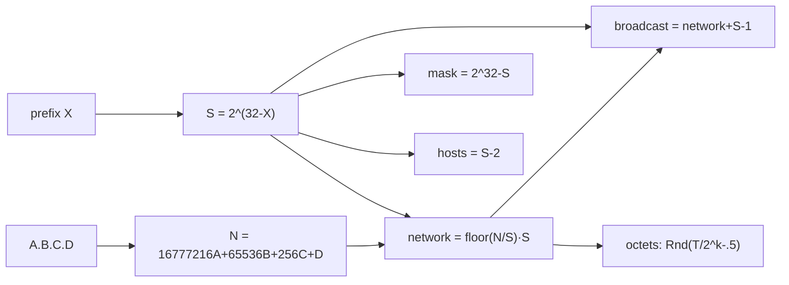

# IPv4 subnet calculator on a Casio fx-991ES PLUS 2nd edition

Everything needed to compute network address, broadcast address, subnet mask and
usable-host count on the fx-991ES PLUS / 2nd edition, using only stock keys.

**Verification status:** the arithmetic was simulated in Python against the
formulas below (see [Verification](#verification)). The calculator-specific
claims come from the official 2nd-edition manual and the keypad. Nothing here
was run on physical hardware, so the two inferred behaviours are flagged:
`Rnd` rounding mode and CALC prompt order.

---

## TL;DR

- **No memory overflow is needed.** The overflow does not raise the 99-byte
  input limit; it only lets you type symbols that are not on the keypad.
- Set **LineIO** and **Fix 0** first. `Fix 0` is mandatory: the floor is done
  with `Rnd(x-.5)`.
- Three programs:
  1. **P1** — all four subnet values as integers (fits, ~87 bytes).
  2. **P2** — network octets directly, `/24`–`/32` only (~29 bytes).
  3. **P3** — any 32-bit integer → four octets (~80 bytes).
- P1 and P3 cannot be merged: 87 + 80 > 99 bytes.

---

## 1. Calculator constraints

From the *fx-570ES PLUS / fx-991ES PLUS / fx-9910NG PLUS (2nd edition) User's
Guide* (2024 PDF) and the keypad:

| Item | Value / behaviour |
|---|---|
| Input capacity | **99 bytes** per calculation; each numeral, symbol or function normally 1 byte, some functions 3–13 bytes |
| Variables | `A`–`F`, `X`, `Y`, `M` |
| Answer memory | `Ans` (direct key). **No `PreAns` on this model.** |
| Integer functions | **No `Int(`, no `Intg(`, no `÷R`** |
| Available functions | `Abs(`, `Rnd(`, `Ran#`, `RanInt#(`, `nPr`, `nCr`, `Pol(`, `Rec(`, `Σ`, `∫`, `d/dx` |
| Multi-statement | `:` separates statements; each `=` executes the next one |
| CALC | Stores one expression, prompts for its variables, COMP/CMPLX only |
| BASE-N logic | `and`, `or`, `xor`, `xnor`, `Not(`, `Neg(` — but **16-bit**, not usable for 32-bit IPv4 |
| Display modes | `MthIO` / `LineIO`; `Fix` / `Sci` / `Norm` |

Consequences:

- Integer division must be built from `Rnd(`; there is no `Int(`.
- 32-bit values fit in the calculator's 10-digit mantissa (`2^32 = 4294967296`).
- The 99-byte limit is the hard constraint on how much one program can output.

---

## 2. Key map

| Character | Keys | Notes |
|---|---|---|
| `:` | `ALPHA` `∫dx` | `:` is the ALPHA function printed above the integral key |
| `Rnd(` | `SHIFT` `0` | `Rnd` is printed above the `0` key |
| `Ans` | `Ans` | direct key, bottom-right next to `=` |
| `^` | `x^□` | power |
| `÷` | `÷` | division |
| `-` `.` `(` `)` | direct | minus, decimal point, parentheses |
| `A` | `ALPHA` `(-)` | `A` printed above the negative key |
| `B` | `ALPHA` `°' "` | |
| `C` | `ALPHA` `hyp` | |
| `D` | `ALPHA` `sin` | |
| `X` | `ALPHA` `)` | prefix variable — not multiplication |
| `CALC` | direct | top-left |

`×` is never typed: the programs rely on Casio's implicit multiplication
(`A2^24` = `A×2^24`, `Rnd(...)2^(32-X)` = `Rnd(...)×2^(32-X)`).

---

## 3. Math

Inputs: octets `A.B.C.D`, prefix `X` (0–32).

```
N = 16777216·A + 65536·B + 256·C + D      (32-bit IP as integer)
S = 2^(32-X)                              (addresses per subnet)
network   = floor(N/S)·S
broadcast = network + S - 1
mask      = 2^32 - S
hosts     = S - 2
```

### Floor without `Int(`

`Rnd(x)` rounds to the current display digits. With **Fix 0** it rounds to an
integer, so:

```
floor(x) = Rnd(x - 0.5)      for x >= 0
```

Check: `x = k+f`, `0 <= f < 1` → `Rnd(k+f-0.5)` rounds to `k` for every `f`.
The only failure is `x = 0`, where `Rnd(-0.5)` rounds away from zero to `-1`.
That only affects `0.0.0.0`.

> **Assumption:** Casio display rounding is half-up (away from zero). The manual
> only says "rounded off". If your unit rounds half-to-even, exact multiples of
> `S` can be off by one. Test: with Fix 0, `Rnd(2.5)` should show `3`.

### Octets from a 32-bit integer `T`

```
O1 = floor(T / 2^24)
O2 = floor(T / 2^16) - 256·O1
O3 = floor(T / 2^8)  - 256·floor(T / 2^16)
O4 = T - 256·floor(T / 2^8)
```



---

## 4. Programs

### P1 — subnet math, integer outputs

```
Rnd((16777216A+65536B+256C+D)÷2^(32-X)-.5)2^(32-X):Ans+2^(32-X)-1:2^32-2^(32-X):2^(32-X)-2
```

- 90 glyphs, **~87 bytes** (one `Rnd(` token).
- `CALC` prompts: `A?` `B?` `C?` `D?` `X?` (order of first appearance).
- `=` presses: network, broadcast, mask, hosts — all integers.

### P2 — network octets directly, `/24`–`/32` only

```
A:B:C:Rnd(D÷2^(32-X)-.5)2^(32-X)
```

- 32 glyphs, **~29 bytes**.
- `CALC` prompts: `A?` `B?` `C?` `D?` `X?`.
- `=` presses: octet 1, octet 2, octet 3, octet 4.
- Valid only for `X >= 24`. For `X < 24` the third octet must be masked too, so
  this program is wrong there.

### P3 — any 32-bit integer → four octets

```
Rnd(T÷2^24-.5):Rnd(T÷2^16-.5)-256Rnd(T÷2^24-.5):Rnd(T÷2^8-.5)-256Rnd(T÷2^16-.5):T-256Rnd(T÷2^8-.5)
```

- 98 glyphs, **~80 bytes** (six `Rnd(` tokens).
- `CALC` prompts: `T?`.
- `=` presses: octet 1, octet 2, octet 3, octet 4.
- Feed it any integer from P1 (network, broadcast or mask).

### Why not one program

| Program | Glyphs | Est. bytes | Fits 99? |
|---|---:|---:|---|
| P1 | 90 | ~87 | yes |
| P2 | 32 | ~29 | yes |
| P3 | 98 | ~80 | yes |
| P1 + P3 merged | — | ~167 | **no** |
| Full dotted-decimal everything | — | ~197 | **no** |

The octet extraction alone is longer than the whole integer program. A single
program cannot output dotted decimal for network + broadcast + mask + hosts.
The memory overflow does not change this: it writes past the input buffer, it
does not extend the 99-byte formula limit.

---

## 5. Setup and run

1. `SHIFT` `MODE` → `2` (LineIO).
   `:` must act as a multi-statement separator; in MathIO it may render as a
   newline instead.
2. `SHIFT` `MODE` → `6` (Fix) → `0`.
   **Mandatory** for the `Rnd(x-.5)` floor.
3. Type the program, press `CALC`.
4. Answer the prompts (A, B, C, D, X for P1/P2; T for P3).
5. Press `=` once per output.
6. Restore normal display later: `SHIFT` `MODE` → `8` (Norm) → `1`.

If you get `Syntax ERROR`, check that `:` came from `ALPHA` `∫dx` (not `SHIFT`),
and that LineIO is set.

---

## 6. Worked examples

### `192.168.1.10/24`

P1: `A=192 B=168 C=1 D=10 X=24`

| `=` | Display | Meaning |
|---|---|---|
| 1 | 3232235776 | network |
| 2 | 3232236031 | broadcast |
| 3 | 4294967040 | mask |
| 4 | 254 | hosts |

P2 (same inputs): `192`, `168`, `1`, `0` → network `192.168.1.0`.

P3 with `T=3232235776`: `192`, `168`, `1`, `0`.

### Other prefixes

| Input | P1 output (net, bc, mask, hosts) | Dotted decimal |
|---|---|---|
| `10.0.0.1/8` | 167772160, 184549375, 4278190080, 16777214 | net `10.0.0.0`, bc `10.255.255.255`, mask `255.0.0.0` |
| `172.16.5.130/26` | 2886731136, 2886731199, 4294967232, 62 | net `172.16.5.128`, bc `172.16.5.191`, mask `255.255.255.192` |
| `203.0.113.7/13` | 3405774848, 3406299135, 4294443008, 524286 | net `203.0.0.0`, bc `203.7.255.255`, mask `255.248.0.0` |
| `192.168.100.200/22` | 3232261120, 3232262143, 4294966272, 1022 | net `192.168.100.0`, bc `192.168.103.255`, mask `255.255.252.0` |
| `8.8.8.8/29` | 134744072, 134744079, 4294967288, 6 | net `8.8.8.8`, bc `8.8.8.15`, mask `255.255.255.248` |
| `1.2.3.4/30` | 16909060, 16909063, 4294967292, 2 | net `1.2.3.4`, bc `1.2.3.7`, mask `255.255.255.252` |
| `255.255.255.255/32` | 4294967295, 4294967295, 4294967295, -1 | net/bc/mask `255.255.255.255` |

---

## 7. Verification

The formulas were simulated in Python with `floor(x) = round_half_away(x-0.5)`
and compared against direct 32-bit arithmetic and octet splitting:

- `/8`, `/13`, `/22`, `/24`, `/26`, `/29`, `/30`, `/32` all matched for
  network, broadcast, mask and all four octets.
- The converter matched the direct octet split for every tested integer.
- The only mismatch is `T = 0`, caused by `Rnd(-0.5)` (see edge cases).

This verifies the **math**. It does not verify the physical calculator's
rounding mode or CALC prompt order.

---

## 8. Edge cases and limitations

| Case | Behaviour |
|---|---|
| `/32` | `hosts = -1` from `S-2`; there is 1 address, 0 usable |
| `/31` | `hosts = 0`; RFC 3021 allows 2, formula does not |
| `/0` | `S = 2^32`; network `0.0.0.0` for any `N < 2^32`; mask `0` |
| `0.0.0.0` | `Rnd(-0.5)` rounds to `-1`, so network/mask octets are wrong; handle manually |
| `X > 32` | undefined; `2^(32-X)` becomes fractional |
| Octet > 255 or negative | not validated; results are garbage |
| `Rnd` rounding | assumes half-up; test `Rnd(2.5)` with Fix 0 |
| CALC prompt order | assumed order of first appearance (manual example `3A+B` prompts A then B) |

---

## 9. Memory overflow

**What it is.** "Basic overflow" is a state where the cursor position exceeds
the length of the formula in the input area (index 208). It is used to type
symbols that are not available in the current mode and to build 100-byte
hackstrings for arbitrary-code-execution research. It is documented at
<casiocalc.wikidot.com/basic-overflow>.

**Why it is not needed here.** Every character in P1–P3 is on the keypad:
`:` is `ALPHA`+`∫dx`, `Rnd(` is `SHIFT`+`0`, `Ans` is a direct key. The
programs fit in 99 bytes, so there is nothing to overflow.

**Why it would not help.** The overflow writes past the input buffer into the
cache/stack area. It does not make the executed formula longer than 99 bytes.
Using it to "fit" a bigger program would corrupt RAM, not run the program.

**Basic-overflow procedure (for reference only).** For calculators with `Σ` and
`CALC`:

1. LineIO.
2. Enter a short formula with `Σ` and no closing parenthesis, e.g. `Σ(X,1,1`.
3. Enter a formula at least 4 bytes longer, e.g. `X=Σ(X,1,123`.
4. `=`.
5. Enter `X=Σ(X,1,1`.
6. `CALC` `=`, get `Syntax ERROR`, press `▶`.

The cursor is then at index 208. Symbols can be overwritten and cycled with the
cursor keys. This is research territory; it is not part of the calculator below.

---

## 10. References

- Casio, *fx-570ES PLUS / fx-991ES PLUS / fx-9910NG PLUS (2nd edition) User's
  Guide*, 2024:
  <https://www.casio.com/content/dam/casio/global/support/manuals/calculators/pdf/2022/mutual/fx-570ES_991ES_9910NG_PLUS_EN.pdf>
  - 99-byte input limit: "Inputting Expressions and Values".
  - Multi-statements: "Multi-Statements".
  - `Rnd`: "Rounding Function (Rnd)".
  - CALC: "Using CALC".
- CASIO fx-ES PLUS exploits wiki, "Basic Overflow":
  <http://casiocalc.wikidot.com/basic-overflow>
- Keypad layout and ALPHA/SHIFT labels: fx-991ES PLUS keypad photo
  (Wikimedia Commons, `File:Fx991esplus.png`); the 2nd edition keeps the same
  key layout.
